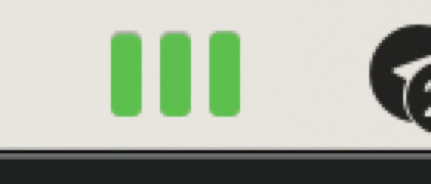
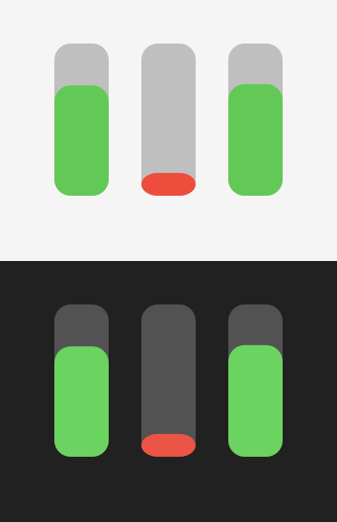

# OpenCode Go Bar

Маленькое приложение для macOS, которое показывает остаток лимитов **OpenCode Go** прямо в строке меню: три полоски — 5 часов, неделя, месяц.





Полоски заполняются по остатку лимита и меняют цвет: зелёный — больше 50 %, оранжевый — больше 20 %, красный — меньше 20 %.

Клик по иконке открывает меню с точными суммами:

```
OpenCode Go  ·  Go
лимит $60.00 / мес  ·  до 24 ноября
5ч   ██████████  96%   $11.47 / $12.00   ↻ 22:34
Нед  ██████████  96%   $28.82 / $30.00   ↻ пн 03:00
Мес  ██████████  98%   $58.82 / $60.00   ↻ 24 нояб.
---
обновлено в 20:28:43
Обновить
Открыть консоль
---
Вид               →  Три полоски / Процент / Оставшиеся доллары
Обновлять         →  1 / 5 / 15 минут
Запускать при входе
---
Выйти
```

## Как это работает

1. Приложение читает OAuth-токен аккаунта OpenCode из локального OpenCode:
   - сначала через HTTP API запущенного сервиса (`~/.local/state/opencode/service.json`, basic auth);
   - если сервис не запущен — напрямую из базы `~/.local/share/opencode/opencode.db` (read-only).
2. С этим токеном запрашивает `https://console.opencode.ai/api/go/status`.
3. Показывает `access.meters.fiveHour / week / month` — лимит, расход и дату сброса.

Токен никуда не сохраняется и не покидает запросы к `console.opencode.ai`. Приложение ничего не пишет в OpenCode.

> **Важно:** `/api/go/status` — внутренний endpoint веб-консоли OpenCode, а не публичный API. Он может измениться без предупреждения. Если консоль переедет на другой адрес или формат, поправьте `Sources/GOAPIClient.m`.

## Сборка

Нужны macOS 13+ и Command Line Tools (`xcode-select --install`). Xcode целиком не требуется.

```bash
./build.sh            # собрать в build/OpenCode Go Bar.app
./build.sh --run      # собрать и запустить
./build.sh --install  # скопировать в ~/Applications и запустить
```

Приложение подписывается ad-hoc — этого достаточно для локального запуска и автозапуска.

## Автозапуск

Меню → **Запускать при входе**. Для регистрации в login items приложение должно лежать в `~/Applications` или `/Applications`; сборка из `build/` может не зарегистрироваться.

## Отладка

```bash
# Проверить токен и данные, не открывая интерфейс
./build.sh --probe

# Посмотреть, что попадёт в меню
"build/OpenCode Go Bar.app/Contents/MacOS/OpenCodeGoBar" --dump-menu

# Перерисовать превью иконки (светлая/тёмная тема)
"build/OpenCode Go Bar.app/Contents/MacOS/OpenCodeGoBar" --icon-preview /tmp/icon.png
```

`--probe` печатает источник токена и все три лимита:

```
token source: OpenCode service
OpenCode Go — тариф Go
Подписка до 24 ноября
5 часов   ██████████ 96%   $11.47 / $12.00  сброс в 22:34
...
```

## Если в строке меню «Go ?»

- **OpenCode не запущен и токен не найден** — откройте OpenCode и войдите в аккаунт OpenCode.
- **Токен не принят** — войдите в OpenCode заново; токен мог истечь.
- **Подписка OpenCode Go не найдена** — проверьте подписку в [консоли](https://opencode.ai/console/go).
- **Нет связи с Console API** — проверьте интернет/VPN; endpoint может быть недоступен из вашей сети.

Последние успешные данные остаются в меню, а красная точка на иконке означает, что обновление не удалось.

## Структура

```
Sources/
  main.m                 точка входа и режимы отладки
  GOAppDelegate.*        строка меню, меню, таймер, автозапуск
  GOMenuBarIcon.*        отрисовка трёх полосок
  GOStatus.*             парсинг ответа Console API
  GOAPIClient.*          запрос /api/go/status
  GOTokenProvider.*      токен из OpenCode (сервис или БД)
  GOHttp.*               синхронный GET
  GOFormat.*             форматирование сумм, процентов, дат
  GOProbe.m              режим --probe
  GOPreview.m            режим --icon-preview
Resources/Info.plist     LSUIElement = true, без иконки в Dock
build.sh                 сборка и установка
```
